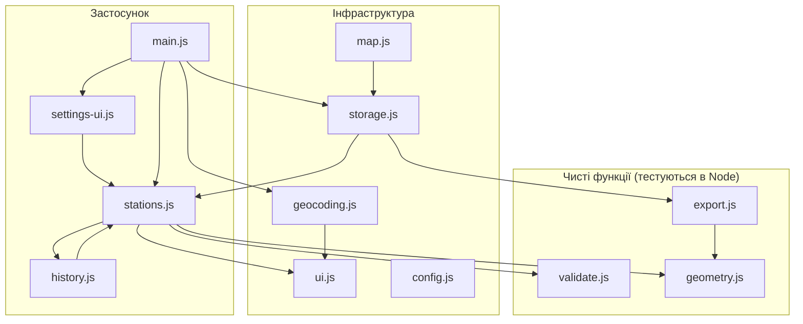

# Огляд архітектури

Одна сторінка (`bsmap.html`, на GitHub — `index.html`), стилі в `css/styles.css`, логіка в 12 класичних скриптах у `js/`. Модулі спілкуються через глобальні функції та змінні (див. [[ADR-001 Класичні скрипти замість ES-модулів]] і [[Глобальний стан]]).

## Шари
1. **Чисті функції** — [[validate.js]], [[geometry.js]], [[export.js]]. Без DOM і Leaflet, тому їх можна завантажити у `vm`-контекст і протестувати ([[Тести]]).
2. **Інфраструктура** — створення DOM ([[ui.js]]), налаштування ([[config.js]]), збереження ([[storage.js]]), карта ([[map.js]]), Nominatim ([[geocoding.js]]).
3. **Застосунок** — модель і відображення станцій ([[stations.js]]), undo/redo ([[history.js]]), панель налаштувань ([[settings-ui.js]]), точка входу ([[main.js]]).

## Головний цикл змін
Будь-яка завершена дія користувача закінчується викликом `commit()` з [[history.js]]:
`зміна станції → render*() → commit() → знімок в undoStack → scheduleSave() → localStorage`.

Під час безперервних дій (подія `input`, перетягування) викликаються лише `render*()`; `commit()` — на `change` / `dragend`.
